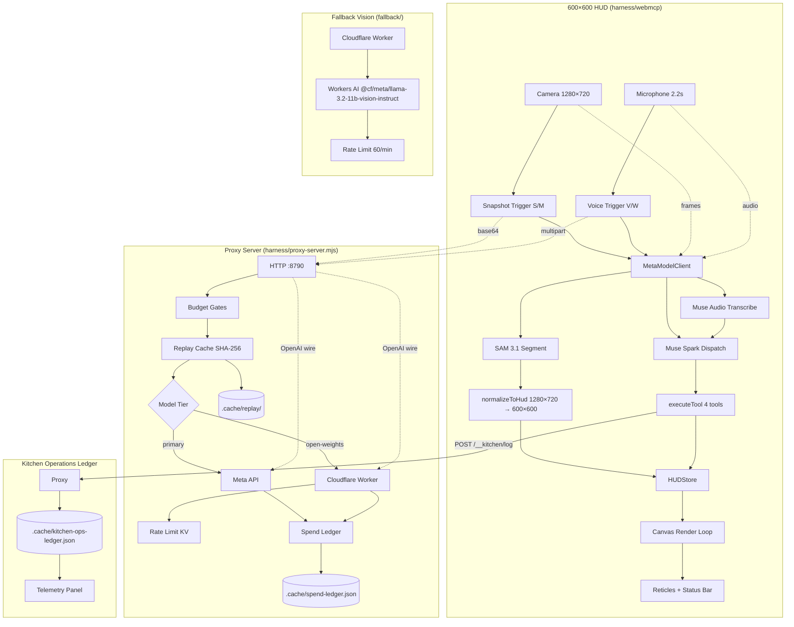
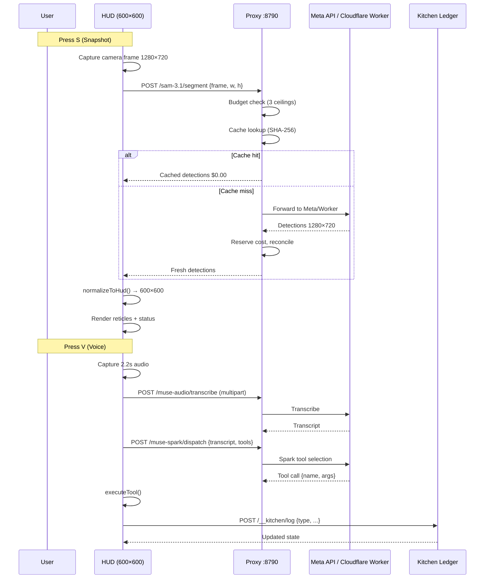

# LineCheck Vision

A kitchen prep and waste-tracking HUD for Ray-Ban-class display hardware. You talk to it, it
looks at the pan in front of you, and it tells you what is wrong before service does.

Built for the **Meta Global AI Developer Hackathon**.

---

## The problem

Commercial kitchens lose money to three things nobody measures in real time: over-portioning,
prep that runs short mid-service, and waste that never gets logged because logging it means
stopping work to write something down. The waste logs that do get written are reconstructed
from memory at close, which is why they are fiction.

LineCheck Vision puts the measurement where the work already happens - in front of the person
holding the pan - so recording it costs a glance and a sentence instead of a clipboard.

---

## What it does

A 600x600 HUD canvas renders detection reticles over whatever the camera sees, with each box
coloured by urgency. Voice drives the same four actions the touch UI would.

| You say | It does |
|---|---|
| "log 2 pounds of salmon trim waste" | `record_waste` - flags the trim zone, logs 907 g as loss |
| "calculate yield on 15 pounds whole chicken down to 10.5 pounds" | `calculate_yield` - 70%, drawn on the HUD |
| "tare scale for deep half pan" | `tare_scale` - zeroes the readout, draws a calibration box |
| "verify pan depth 4-inch hotel pan" | `verify_pan_depth` - warns when fill is out of the 20-90% band |

---

## Architecture


## Architecture Diagram



---

## Data Flow Diagram



---

## Kitchen Operations Ledger Flow

```mermaid
flowchart LR
    subgraph TOOLS[WebMCP Tools]
        T1[record_waste]
        T2[calculate_yield]
        T3[tare_scale]
        T4[verify_pan_depth]
    end

    subgraph PROXY[Proxy /__kitchen/*]
        LOG[POST /log]
        STATE[GET /state]
        RESET[POST /reset]
    end

    subgraph STORE["Kitchen Ledger Store"]
        PAR[(parStock: {ingredient: {parG, currG}})]
        WASTE[(wasteLog[])]
        YIELD[(yieldLog[])]
        TARE[(activeContainer, activeTareG)]
        AUDIT[(panDepthAudit[])]
    end

    TOOLS --> LOG
    LOG -->|mutate| PAR
    LOG -->|append| WASTE
    LOG -->|append| YIELD
    LOG -->|update| TARE
    LOG -->|append| AUDIT
    STATE -->|read| PAR
    RESET -->|clear| PAR
    PAR -->|poll 5s| PANEL[Telemetry Panel T]
```

---

## Quick-Start (90 seconds)

### Prerequisites
- Node 18+ (tested on 20)
- No Meta API key needed - runs on local mocks by default

### 1. Clone & Install
```bash
git clone https://github.com/zumayaaustin-creator/LineCheck-Vision-Hackathon.git
cd LineCheck-Vision-Hackathon/harness/webmcp
npm install
```

### 2. Run Mock-First (zero credits, zero keys)
```bash
npm run dev
# Opens http://localhost:5173
# HUD shows: SAM 3.1: MOCK (default)
```

### 3. Test the Four Kitchen Actions

| Key | Action | Mock Result |
|-----|--------|-------------|
| `1` | `tare_scale {unit:"g"}` | Sets active tare, no visual change |
| `2` | `calculate_yield {ap:2200, ep:1650, trim:550}` | 75% yield logged |
| `3` | `verify_pan_depth {pan:"1/6 Pan", fill:15%}` | Warning reticle (fill < 20%) |
| `4` | `record_waste {ingredient:"Pork Collar", weight:450, reason:"Silver Skin"}` | ALERT reticle, waste logged |

Press `T` to open the **Telemetry Panel** — shows live inventory, waste/yield log, tare, ledger status.

### 4. Test Snapshot (SAM 3.1)
```bash
# In another terminal
node harness/mock-server.mjs
# Creates http://127.0.0.1:8787

# Create harness/webmcp/.env.local:
VITE_USE_MOCK_META=false
VITE_META_API_KEY=local-test-token
VITE_SAM_MODEL_ENDPOINT=http://127.0.0.1:8787/sam-3.1/segment
VITE_MUSE_AUDIO_ENDPOINT=http://127.0.0.1:8787/muse-audio/transcribe
```

Restart `npm run dev`. Press `S` → HUD shows live detections from mock server:
- 1/3 Hotel Pan (68% fill, nominal)
- Salmon Trim Zone (12% fill, **warning**)
- Scale Tare Zone (55% fill)
- Overflow Probe (clamped to canvas edge)

### 5. Test Voice Chain
Press `V` → synthetic audio → mock Muse transcript → Spark tool pick → tool executes → kitchen ledger updated.

Press `M` for real microphone (falls back to synthetic if no device/permission).

### 6. Run Proxy with Budget Enforcement
```bash
cd harness
META_API_KEY=local-test-token UPSTREAM_BASE=http://127.0.0.1:8787 node proxy-server.mjs
# Starts http://127.0.0.1:8790
# GET /__usage shows spend ledger
```

### 7. Run Tests
```bash
cd harness
node --test tests/proxy-fallback.test.mjs
# 11/11 pass: failover, budget, circuit breaker, tier routing
```

---

## Environment Variables

| Variable | Default | Purpose |
|----------|---------|---------|
| `VITE_USE_MOCK_META` | `true` | `false` = hit real/mock upstream |
| `VITE_USE_PROXY` | `false` | `true` = browser calls proxy, no key needed |
| `VITE_META_API_KEY` | `""` | **Never put real key here** — Vite inlines it |
| `VITE_SAM_MODEL_ENDPOINT` | - | Override SAM endpoint |
| `VITE_MUSE_AUDIO_ENDPOINT` | - | Override Muse endpoint |
| `VITE_WAKE_MODE` | `auto` | `speech` \| `vad` \| `auto` |
| `VITE_SNAPSHOT_MIN_INTERVAL_MS` | `1500` | Client-side throttle floor |
| `PROXY_PORT` | `8790` | Proxy HTTP port |
| `META_API_KEY` | `""` | **Server-side only** — real key lives here |
| `UPSTREAM_BASE` | - | Base URL for all Meta endpoints |
| `MAX_PAID_CALLS` | `60` | Hard call ceiling |
| `MAX_SPEND_USD` | `120.00` | Lifetime USD ceiling (persists) |
| `MAX_SESSION_SPEND_USD` | `5.00` | Per-process ceiling |
| `PROXY_CACHE_MODE` | `record-or-replay` | `off` \| `record-only` |
| `FALLBACK_MODE` | `off` | `auto` = primary→open-weights failover |
| `FALLBACK_TIER` | `open-weights` | Fallback tier name |

---

## Fallback Mock Responses

The mock server (`harness/mock-server.mjs`) returns these exact shapes:

### SAM 3.1 Segment
```json
POST /sam-3.1/segment
{
  "frame": "<base64>", "width": 1280, "height": 720
}
→
{
  "detections": [
    {"id":"sam-pan-1","label":"1/3 Hotel Pan - Sliced Tomato","x":120,"y":180,"width":320,"height":210,"confidence":0.96,"fill_percentage":68},
    {"id":"sam-salmon-trim","label":"Salmon Trim Zone","x":560,"y":140,"width":280,"height":190,"confidence":0.91,"fill_percentage":12},
    {"id":"sam-scale-zone","label":"Scale Tare Zone","x":900,"y":430,"width":260,"height":170,"confidence":0.88,"fill_percentage":55},
    {"id":"sam-overflow","label":"Overflow Probe (Right Edge)","x":1180,"y":300,"width":300,"height":200,"confidence":0.74}
  ],
  "meta": {"model":"sam-3.1-mock","sourceFrame":{"width":1280,"height":720},"overflowBoxRight":1480,"simulated":true}
}
```

### Muse Audio Transcribe
```json
POST /muse-audio/transcribe (multipart: audio, hint?)
→
{
  "transcription": "log 2 pounds of salmon trim waste",
  "reply": "Logged 907 g of salmon trim. That is a 12% loss on the case.",
  "action": "NOTIFY_PREP",
  "tool": {"name":"record_waste","arguments":{"ingredient":"Salmon Trim","weight_g":907,"reason":"Trim waste"}},
  "meta": {"model":"muse-mock","scenario":"record_waste","audioBytes":2048}
}
```

### Muse Spark Dispatch
```json
POST /muse-spark/dispatch
{"transcript": "...", "tools": [...]}
→
{
  "tool": {"name": "record_waste", "arguments": {"ingredient": "Salmon Trim", "weight_g": 907, "reason": "Trim waste"}},
  "confidence": 0.95,
  "source": "mock",
  "telemetry": {"modelTier": "primary"}
}
```

### Kitchen Ledger State
```json
GET /__kitchen/state
→
{
  "version": 1,
  "parStock": {"Default Ingredient": {"parGrams": 5000, "currentGrams": 5000, "unit": "g"}},
  "wasteLog": [],
  "yieldLog": [],
  "activeContainer": null,
  "activeTareGrams": 0,
  "panDepthAudit": [],
  "createdAtUtc": "...", "updatedAtUtc": "..."
}
```

---

## Verify Your Build

```bash
# 1. Lint + TypeCheck + Build
cd harness/webmcp && npm run build

# 2. Proxy tests (11/11)
cd ../.. && node --test harness/tests/proxy-fallback.test.mjs

# 3. Open HUD
npm run dev  # or serve dist/ with http-server
# Open http://localhost:5173 (or https://localhost:8081 with mkcert)
```

---

## Security Checklist

- [ ] No `VITE_META_API_KEY` with real value in repo
- [ ] Proxy runs server-side with `META_API_KEY`
- [ ] `MAX_PAID_CALLS` and `MAX_SPEND_USD` set for production
- [ ] `PROXY_ALLOWED_ORIGINS` restricted to your domains
- [ ] `.cache/` gitignored (contains spend ledger + replay cache)


```
  camera frame ──snapshot (S key / snapshot event)──┐
                                                    ▼
                                          ┌──────────────────┐
  microphone ──2.2s capture (M key)──►    │   MetaModelClient │
                                          │  mock │ live      │
                                          └────────┬─────────┘
                     SAM 3.1 ◄─────────────────────┤
                     (boxes in 1280x720)           │
                                                   ▼
                                    normalizeToHud()  1280x720 -> 600x600
                                    clamp · status · drop bad
                                                   │
                                                   ▼
                                          ┌──────────────────┐
                                          │    HUDStore      │  typed, subscribable
                                          │ IDLE LISTENING   │
                                          │ PROCESSING ALERT │
                                          └────────┬─────────┘
                                                   ▼
                                      600x600 canvas render loop
                                                   ▲
                     Muse Voice ◄──────────────────┤
                     (transcript + tool call)      │
                                                   ▼
                                    executeTool() -> tools.ts (4 tools)
```

Two rules hold the whole thing together:

1. **Nothing calls a paid endpoint on a timer.** SAM runs on an explicit snapshot event, Muse on
   an explicit wake event. The render loop is pure drawing and never touches the network -
   verified at 0 fetch calls across 4 seconds of animation frames.
2. **Everything the model returns is normalised into HUD space before the UI sees it.** The HUD
   is a fixed 600x600 and must never draw a box outside itself, whatever the model sends.

---

## Running it

```bash
cd harness/webmcp
npm install
npm run dev          # http://localhost:5173
npm run build        # -> dist/
```

Out of the box it runs **entirely on local mocks** - no key, no credits, no network.

### Keyboard map

| key | action |
|---|---|
| `S` | one SAM 3.1 snapshot |
| `M` | hold a 2.2s microphone capture, then send to Muse |
| `W` | toggle the hands-free wake word |
| `C` | restart the camera capture |
| `V` | one Muse utterance using synthetic audio |
| `1` `2` `3` `4` | tare_scale · calculate_yield · verify_pan_depth · record_waste |
| `0` | clear the HUD |

### Going live without spending anything

`harness/mock-server.mjs` implements both contracts locally, so the real `fetch()` path can be
exercised for free. `harness/proxy-server.mjs` keeps the credential server-side. See
[`harness/README.md`](harness/README.md) for both, plus failure injection
(`?simulate=latency|slow|401|500`).

---

## Status, stated plainly

| part | state |
|---|---|
| HUD canvas, store, 4 kitchen tools | **working** |
| Coordinate normalisation 1280x720 -> 600x600 | **working, tested against edge cases** |
| Mock-first / live switch | **working** |
| Snapshot + voice throttling | **working** |
| Local mock contracts (SAM 3.1 + Muse) | **working** |
| Server-side key proxy with cost ceiling | **working** |
| Microphone capture | **working, with graceful fallback** |
| USD spend ledger + reconciliation | **working** - persistent, self-calibrating from upstream usage |
| Content-addressed replay cache | **working** - pay once per unique frame/command |
| Real camera capture | **working** - 1280x720 with synthetic fallback |
| Wake word ("line check") | **working** - speech recognition, VAD fallback, $0.00 |
| Live Meta SAM 3.1 / Muse calls | **not yet** - contract shapes settled, real endpoints not wired |

The live branch has only ever spoken to the local mock. It has never contacted Meta, and no real
API key exists in this repository.

---

## Layout

```
specs/architecture/System-Spec.md   hardware and pipeline intent
sprints/Sprint-01.md                budget allocation and deliverable checklist
AGENTS.md                           isolation boundary for contributors and agents

harness/mock-server.mjs             local contract server (no dependencies)
harness/proxy-server.mjs            server-side key proxy + cost ceiling
harness/sam-3.1/detections.mjs      SAM contract fixture (unnormalised 1280x720)
harness/muse-audio/transcripts.mjs  Muse contract fixtures -> the four tools
harness/README.md                   contracts, injection modes, security notes

harness/webmcp/src/main.ts          canvas loop, hotkeys, snapshot + voice triggers
harness/webmcp/src/config/env.ts    mock-first env resolution
harness/webmcp/src/hud/state.ts     typed reactive HUDStore
harness/webmcp/src/mcp/normalize.ts 1280x720 -> 600x600 with clamping
harness/webmcp/src/mcp/tools.ts     the four WebMCP tools + dispatch
harness/webmcp/src/mcp/client.ts    MetaModelClient, mock and live branches
harness/webmcp/src/mic.ts           bounded microphone capture
```

---

## Security note

Vite inlines every `VITE_*` value into the browser bundle. A Meta API key placed in
`VITE_META_API_KEY` would be readable by anyone who loads the page. Use `harness/proxy-server.mjs`
and `VITE_USE_PROXY=true`: the browser then holds no credential at all, and the proxy enforces a
hard `MAX_PAID_CALLS` ceiling.

---

## The boundary

`AGENTS.md` defines this repo as the **public demo harness**. LineTare and LineCheck Live
proprietary logic deliberately lives elsewhere and is not present here, in any branch or commit.
